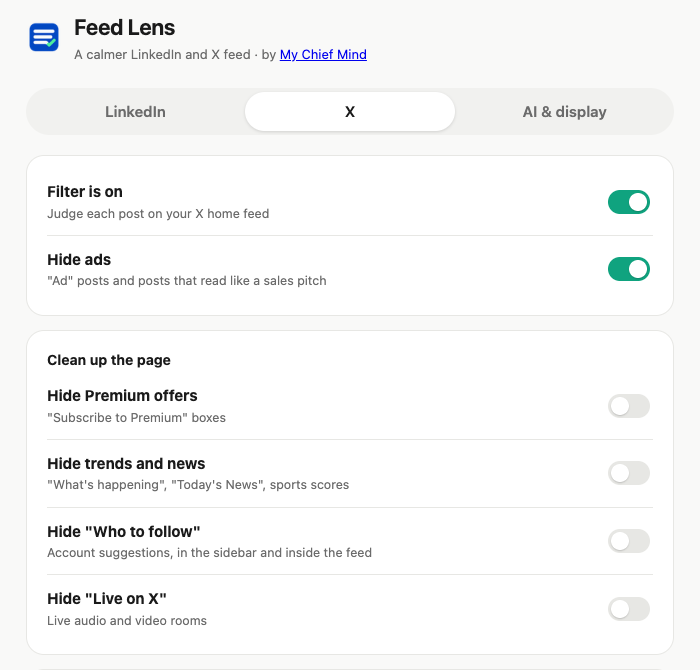

<p align="center"></p>

# Feed Lens

By [My Chief Mind](https://MyChiefMind.com).

Chrome extension for the **LinkedIn** home feed (`linkedin.com/feed`) and the
**X** home feed (`x.com/home`, plus Explore). It asks an AI (TypeSafe Jev) about
each post, shows the ones that match your interests, and folds away the rest.
It does nothing on any other page or site.

Each site has its own tab in Settings, with its own topics and popularity limits.

On X it can also clean up the page (each is a switch, off by default):

- hide ads and posts that read like a sales pitch
- hide "Subscribe to Premium" boxes
- hide trends and news ("What's happening", "Today's News", sports scores)
- hide "Who to follow" suggestions, in the sidebar and inside the feed
- hide "Live on X" rooms

<p align="center"></p>

## Install

Step-by-step guide with screenshots: [docs/HOW-TO-INSTALL.md](docs/HOW-TO-INSTALL.md).

```bash
npm ci
npm run build
```

1. Open `chrome://extensions` and turn on **Developer mode**.
2. Click **Load unpacked** and pick the `dist/` folder.
3. Open the extension's **Settings**, paste your TypeSafe API key, list what you like and what to hide (per site), and save.

The key is stored only in your browser (`chrome.storage.local`). In AI mode each
post's author and text (up to 1500 characters) is sent to `api.typesafe.ai`.
Keyword mode is free and sends nothing.

If anything fails (no key, network error, bad answer), posts stay visible.

## Test

```bash
npm test
```

Unit tests cover the decision logic. End-to-end tests load the built extension in
Chromium against fake LinkedIn and X feed pages and a fake TypeSafe API (no real traffic).
