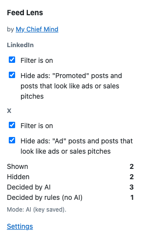
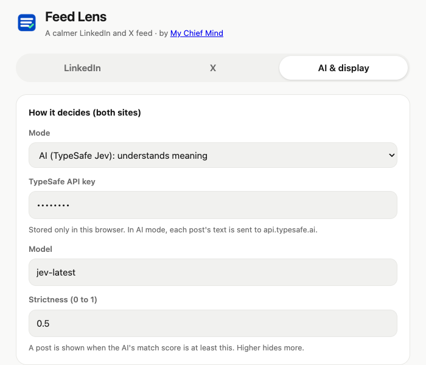
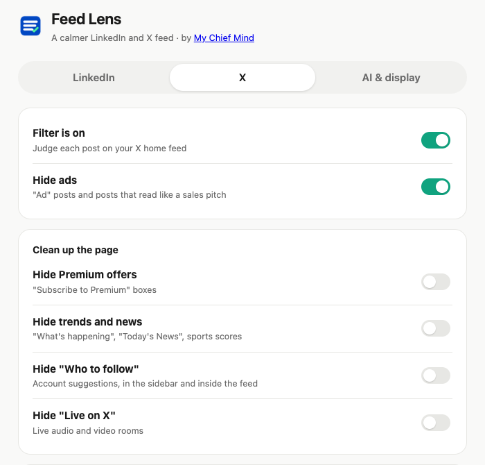

# Install Feed Lens

Feed Lens folds away ads and posts you don't care about on your **LinkedIn** and
**X** home feeds. Each folded post gets a small bar with a **Show** button, so
nothing is lost. Takes about 3 minutes. Works in Google Chrome on a computer.

## Steps

1. **Unzip** `feed-lens.zip`. Move the `feed-lens` folder somewhere it can stay
   (like *Documents*). Don't delete it later: Chrome uses it.
2. **Open** `chrome://extensions` in Chrome.
3. **Turn on Developer mode** (switch at the top right).
4. **Click Load unpacked** and pick the `feed-lens` folder itself.
5. **Pin it**: click the puzzle piece 🧩, then the pin 📌 next to **Feed Lens**.

   

6. **Choose your settings**: click the icon, then **Settings**.
   - No AI key? Set **Mode** to **Keywords only**. Free, works right away.
   - Have a TypeSafe AI key? Keep **AI** mode and paste your key (get one at `typesafe.ai`).
   - The **LinkedIn** and **X** tabs each have their own *I like* and *Hide* lists.
   - On the **X** tab you can also hide Premium offers, trends and news,
     "Who to follow" and "Live on X".

   

   

7. **Open** `linkedin.com/feed` or `x.com/home`. Every post gets a small bar:
   - ✅ **Checked**: shown to you, with the reason
   - 🙈 **Collapsed**: folded away. Click **Show** to read it anyway

## Good to know

- The icon's popup has quick switches per site: **Filter is on** and **Hide ads**.
- It only touches the LinkedIn home feed and the X home and Explore pages.
- In AI mode each post's text is sent to TypeSafe AI to decide. Nothing is
  posted, liked or sent on LinkedIn or X.
- Chrome may warn about "developer mode extensions". That's normal for test versions.
- **New version?** Replace the folder, then click ↻ on the extension card.
- **Remove it:** click **Remove** on that same card.
